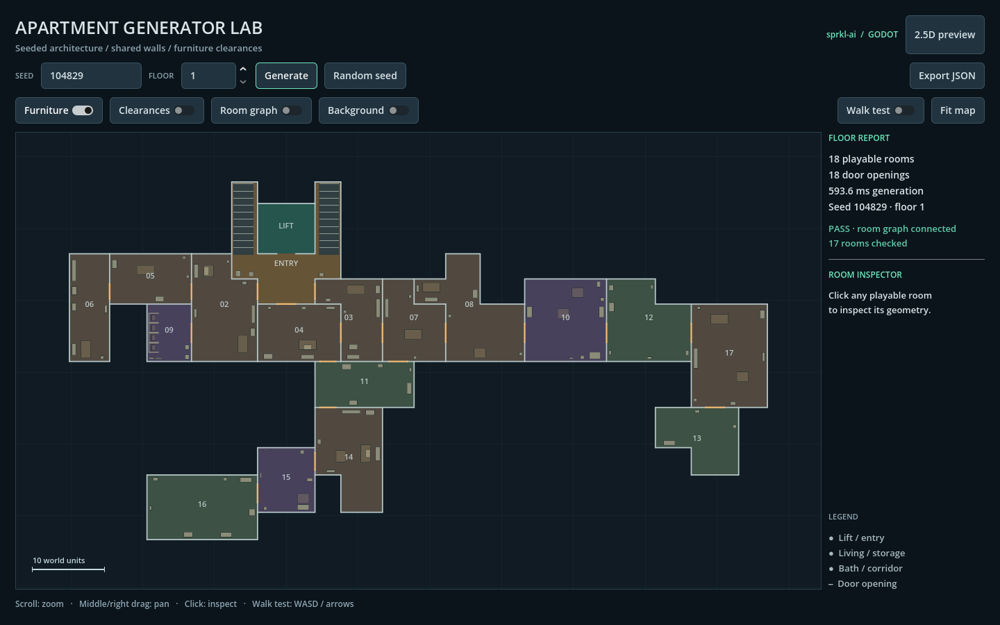
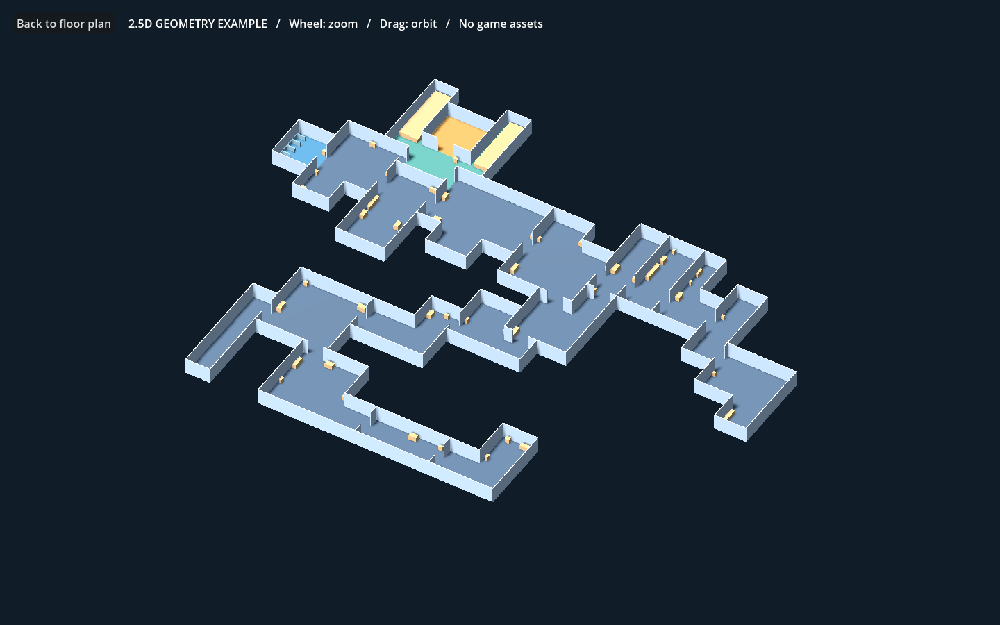

# Godot Apartment Generator

**Seeded apartment floors and entrance landings for Godot 4 / 2.5D games.**

Extracted from *The way to Chekushka*: irregular room
contours, shared walls, door openings, an elevator landing, connected expedition
routes and furniture placement with conservative traversal checks.

The algorithm returns data. Render it as a floor plan, build a 3D environment,
or replace the example meshes with your own modular kit.

[Русское описание](README.ru.md) · [Integration and coordinates](#use-the-generator-in-your-game)





## Run

Tested with **Godot 4.7.1**, GDScript, Compatibility renderer. No add-ons,
autoloads, accounts, game artwork, Python or server are required to run the demo.
Earlier Godot versions have not been verified.

1. Import `project.godot` in Godot and let the initial script scan finish.
2. Press **F6** on `demo/main.tscn` or **F5** to run the workbench.
3. Enter a signed integer seed and floor number, then **Generate**.
4. Enable **Furniture**, **Clearances**, **Graph** or **Background**.
5. Use **2.5D preview** to view the same generated floor with example 3D meshes.

Floor plan: wheel zooms; middle/right drag pans; click inspects a room.
**Walk test** enables WASD/arrows for a collision-aware circular probe.
**Export JSON** saves geometry to a location you choose. The graph overlay is
room adjacency, not a navigable centre-to-centre movement path.

## Use the generator in your game

Copy `core/` and `data/` into your Godot project. Keep their `res://` paths, then
allow Godot to rescan the global script classes. This extraction uses global
`Endless*`/`RoomDef` class names; rename them and update type references if your
project already defines these classes.

```gdscript
const Scheme: Resource = preload("res://data/balance/endless_scheme.tres")

func create_floor(run_seed: int, floor_number: int) -> void:
    var floor_data: EndlessFloorData = EndlessGenerator.new().generate(
        run_seed, floor_number, Scheme
    )
    for room: RoomDef in floor_data.level.rooms:
        # Use room.areas, room.wall_segments and room.colliders.
        # room.bounds is only a bounding box: L/T rooms have empty corners!
        pass
```

For the supplied 3D renderer, also copy `examples/level_geometry_3d.gd`:

```gdscript
const Geometry = preload("res://examples/level_geometry_3d.gd")

func render_floor(floor_data: EndlessFloorData) -> void:
    var view: Node3D = Geometry.new()
    view.create_collisions = true # Static collision for the blockout geometry.
    add_child(view)
    view.build(floor_data)
```

`demo/lab_model.gd` is an optional inspection/export adapter, not a requirement
for generating levels. `examples/preview_25d.tscn` is a standalone orthographic
camera example. Example furniture uses simplified boxes; the source footprints
remain available to substitute your own visuals/collision setup.

The 3D example uses boxes for non-rectangular filled furniture, including circles
and capsules. Its optional colliders follow that conservative blockout
approximation. Unfilled polygon partitions follow their actual segments. For
exact custom physics, construct primitives from the exported shape/radius/points/
thickness/closed/filled fields or the full `LevelColliderDef` resources.

## How it works

1. Derive a deterministic floor seed from the run seed and floor number.
2. Partition a complete building envelope, reserving the lift and landing.
3. Select connected playable branches and loops from the room graph.
4. Produce shared boundary segments and physical door cuts once.
5. Reserve encounter/architectural space, then place semantic room furnishings.
6. Reject furniture placements that break the existing conservative traversal
   regions or block door approach reservations.

Two random streams are used: the ported `DotNetRandom` architecture stream and
Godot's furniture stream. Reproducibility is verified on the pinned engine;
cross-engine-version bit-identical generation is not promised.

### Coordinates and data contract

- Internal architectural calculations retain the original +Y-up convention.
- `RoomDef`, doors, colliders and exported JSON are **final Godot 2D, +Y down**.
- In 3D, map `(x,y)` to `(x,height,z=y)`. Do not negate Y again.
- `room.areas` is the actual floor union. `wall_segments` already contain door
  cuts. `colliders` contain shape, rotation, solidity and dressing metadata.
- `level.rooms` are playable; `master_rooms` are the whole architectural envelope.
- Active `data.nodes[i].links` reference **active indices**, whereas
  `active_master_indices` maps these back to the building envelope.
- `RoomDef` still includes historical gameplay marker fields. They are data
  only; this project never instantiates enemies, items or network sessions.

### Settings

Edit `data/balance/endless_scheme.tres` for building dimensions, room size limits,
landing proportions, doors and playable-route selection. Furnishing footprints,
body radius and conservative passage width live in `endless_furnishing_stats.tres`.
Some settings are calibrated together: arbitrary incompatible limits can exhaust
the generator's retry budget. This is an extracted generator, not a universal
constraint solver for every building grammar.

### Clearance audit limits

The mint clearance layer is a conservative grid around actual walls/furniture.
The workbench separately checks graph connectivity and whether the nearest clear
cells at room doors share a grid component. **Audit warnings are displayed rather
than hidden.** Some production seeds produce conservative door-lane warnings;
these are not a proof that a real character is trapped, nor a guarantee that
every character size can pass. Use walk test, inspect narrow rooms and validate
your chosen movement body against your own collision system before shipping.
Decorative stairs and 3D example meshes are not an authored multi-storey staircase
navigation system.

## Tests

```sh
godot --headless --editor --path . --quit
godot --headless --path . --script res://tests/run.gd
```

The focused suite checks multiple seeds/floors, deterministic layouts, graph
connectivity, unique landings, collision-aware probe movement and JSON export.
Nine SHA-256 reference layouts were generated using the source game's generator
and compared with the extraction. Results are in `docs/test_results.json`;
native workbench checks are in `docs/ui-checks.json`.

Optional native integration checks (open a rendering window and exit):

```sh
godot --path . --script res://tests/ui_probe.gd
godot --path . --script res://tests/preview_25d_probe.gd
```

These scripts exercise controls/scene changes and update the images in `docs/`.
They are scripted smoke tests, not a full human playthrough.

## Source, attribution and license

MIT — see [LICENSE](LICENSE) and [NOTICE](NOTICE).

Based on the collaborative Godot project
[The way to Chekushka](https://github.com/samarsky-gamedev/The-way-to-Chekushka),
revision `b2861b4b86b5`. Attribution is retained in `NOTICE`.
`docs/source_manifest.json` records the upstream extraction hashes and the
current published hashes separately. Comment cleanup preserves executable code;
layout fingerprints verify the production geometry.

`python tools/extract_from_game.py /path/to/source-game --output /tmp/upstream-snapshot`
reproduces the upstream snapshot (Python 3, Git). The output directory must be
new or empty so refreshing upstream cannot overwrite the curated library.
It removes runtime trash-art catalogue loading and retains the unchanged item-ID
enum plus plant predicate instead of the game's inventory implementation. No source game art or
third-party add-ons are redistributed here.
